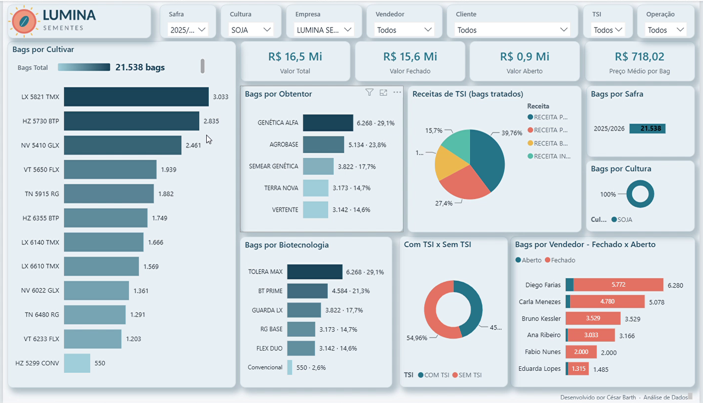
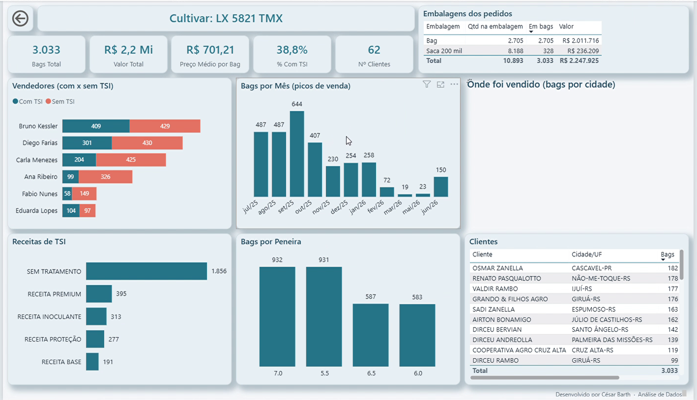
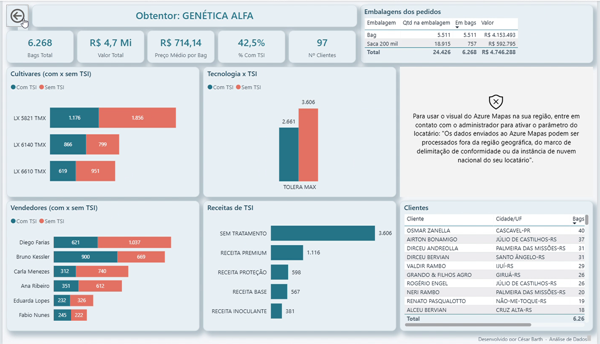
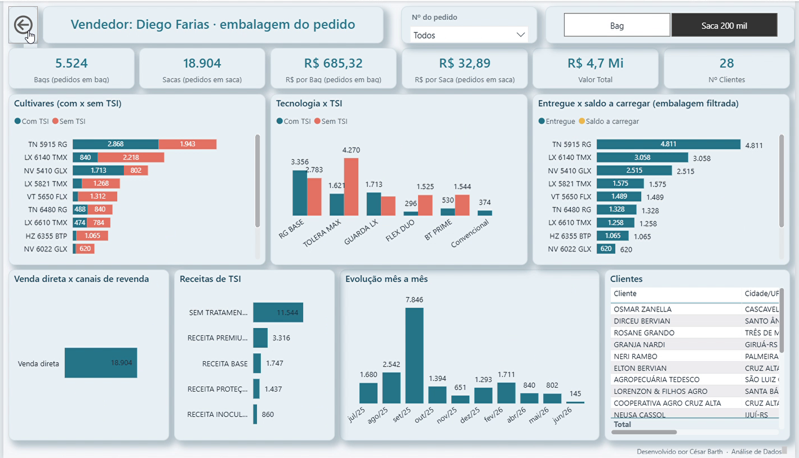
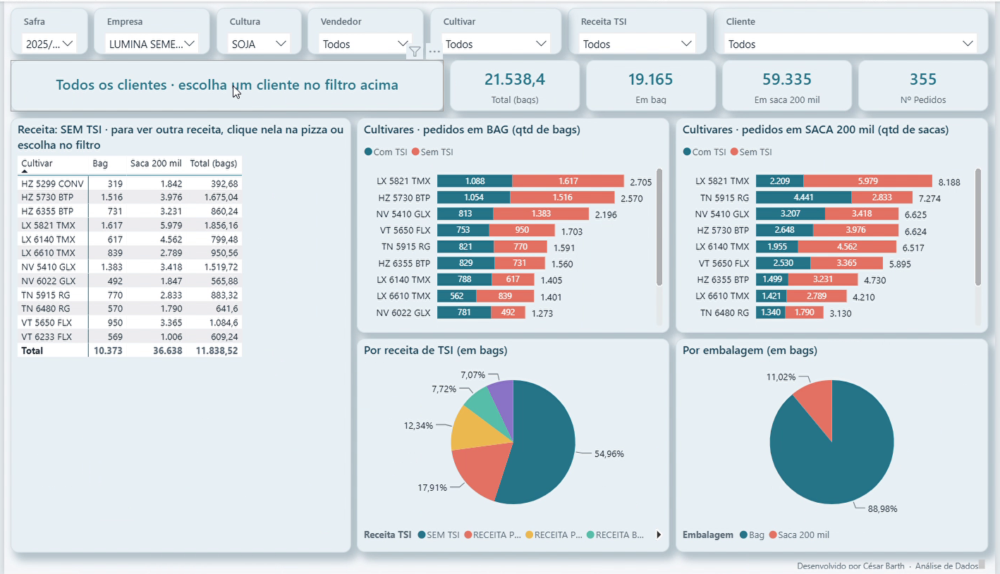

# Seed Sales Orders Dashboard — Power BI

🇺🇸 **English** | 🇧🇷 [Português](README.pt-BR.md)

A sales dashboard for a seed company (soybean, wheat, oats and corn), built in **Power BI (PBIP/TMDL format)**.
All data in this repository is **synthetic**, generated by a Python script. The company "Lumina Sementes", its customers, sales reps, seed varieties and prices are all fictional.

> Based on a real project I built for a seed company in Southern Brazil, where it replaced an outsourced reporting solution. This public version keeps the same data model, DAX measures and report design, with fictional data.

## What the dashboard shows
- **Overview** (*Visão Geral*): total value, closed × open orders, average price per bag, and rankings by variety, breeder, biotech trait, seed treatment (TSI) recipe, season and sales rep. Clicking any chart filters the whole page.
- **Drill-through pages**: by variety, breeder, seed treatment recipe, biotech trait, treated × untreated and sales rep. Each page has KPIs, a map by city, monthly trend and a customer table.
- **Variety × Treatment × Packaging**: customer-level matrix requested by the sales team, with quantities in the original packaging and converted to bags.

## Screenshots
| Overview | Variety detail |
|---|---|
|  |  |
| **Breeder detail** | **Sales rep × Packaging** |
|  |  |

**Variety × Treatment × Packaging**

## Technical highlights
- **Unit conversion**: every packaging type (5-million-seed bag, 200k-seed sack, big bag, kg sacks) is converted into a single "bag" unit with crop-specific rules, via a calculated column `FATOR_BAG`.
- **Business rules reconciled with the ERP**: cancelled items excluded; closed items count only the invoiced quantity (`QTD_EFETIVA`); seed-treatment value is proportional.
- **Main sales rep × reseller channels** through a mapping table (`dVendedorPrincipal`).
- **DAX**: dynamic format strings, dynamic titles, and a total rendered as an SVG image by a measure.
- **PBIP / TMDL** project, fully readable and versioned in Git.
- **Validation first**: in the real project, every figure was checked against ERP reports before going live.

📄 All measures, calculated columns and rules: [docs/MEDIDAS_DAX.md](docs/MEDIDAS_DAX.md) (in Portuguese, DAX code is language-neutral).

## Glossary (Portuguese terms in the model)
| Term | Meaning |
|---|---|
| Safra | Crop season (Jul–Jun) |
| Cultivar | Seed variety |
| Obtentor | Breeder / variety owner |
| TSI (Tratamento de Sementes Industrial) | Industrial seed treatment |
| Bag / Saca 200 mil | 5-million-seed bag / 200k-seed sack |
| Fechado × Aberto | Closed × open orders |
| Vendedor / Canal | Sales rep / reseller channel |

## How to open
1. Run `dados/gerar_base_ficticia.py` (Python 3, standard library only). It creates `pedidos_ficticios.csv`.
2. Open `Pedidos_Sementes.pbip` in Power BI Desktop.
3. Go to **Home → Transform data → Edit parameters** and set `Pasta_Dados` to the `dados\` folder (with the trailing backslash).
4. Click **Refresh**.

## Stack
Power BI · DAX · Power Query (M) · TMDL/PBIP · Python · SQL (real project)

---
Developed by **César Barth** · Data Analytics · [LinkedIn](https://www.linkedin.com/in/barthcesar07)
